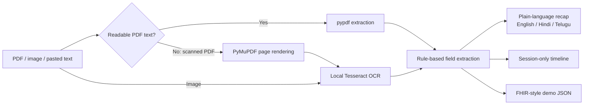

# Aarogya — AI-Powered Personal Health Copilot

A Streamlit prototype for collecting health report text, extracting a few explicit fields, and reviewing them in a session-level timeline. Despite the challenge framing, this starter intentionally uses transparent local rules rather than claiming to connect to an AI model.

## Run locally

1. Create and activate a Python virtual environment.
2. Install the Python dependencies: `pip install -r requirements.txt`
3. Start the app: `streamlit run app.py`

Text-based PDFs are parsed with pypdf. Image uploads and scanned PDFs use Tesseract OCR; install the Tesseract application separately and make sure `tesseract.exe` is on `PATH`. The hosted app installs English and Telugu Tesseract data and uses both when available. For local bilingual OCR, install the Telugu language data (usually `tel.traineddata`) in the Tesseract tessdata directory. OCR quality depends on the document and is not reliable for handwriting.

## Website screens

- **Overview:** Session record counts, a first-record call to action, and recent uploads.
- **Add a record:** Upload a PDF/image or paste report text, assign a category, and review extracted text before relying on it.
- **Health summary:** Choose a source record, view its rule-based recap in English, Hindi, or Telugu, optionally request an AI-generated explanation, and download a plain-text summary.
- **Compare reports:** Compare repeated lab-test names across records without treating differences as a clinical trend.
- **Ask your report:** Search one record locally or, after explicit consent, request an AI answer grounded in the selected record.
- **Term guide:** Browse a small, curated medical glossary in English or Telugu.
- **Timeline:** Search and filter records by category; extracted report dates and details remain linked to their source.
- **FHIR / ABHA demo:** Preview and download a mock FHIR-style JSON bundle.
- **How it works:** Review the extraction pipeline, data model, and limitations.

The layout adapts to narrow screens. Navigation and records remain within the active Streamlit session.

## Optional cloud AI

AI-generated summaries and report answers use OpenAI's `gpt-4o-mini` model. They are only requested when a user opts in on the relevant screen. The selected report's extracted text (and the question for Q&A) is sent to OpenAI; review OpenAI's current data policies before enabling this for any sensitive information.

To configure the app, add this to Streamlit Community Cloud's **App settings → Secrets** (or set `OPENAI_API_KEY` in the environment for a local run):

```toml
OPENAI_API_KEY = "your-key"
```

Never commit or share the key. The current public demo has no user accounts, access controls, or per-user quotas. Anyone who can access it may be able to use a configured shared key and incur API costs, so do not configure a paid key on the public demo until access and usage limits are in place. Without a key, the existing local summary and lookup continue to work.

## Publish a shareable website

The `localhost` address is only reachable from the computer running Streamlit. To let people open the app from other networks, deploy it to a public host:

1. Create a GitHub repository and add `app.py`, `requirements.txt`, `packages.txt`, `README.md`, `test_app.py`, and `.gitignore`. Do not upload `.venv`, uploaded health records, or secrets.
2. Open [Streamlit Community Cloud](https://share.streamlit.io/) and sign in with GitHub.
3. Choose **Create app**, select the repository and branch, and set the app file to `app.py`.
4. Choose **Deploy**. Once deployment finishes, share the HTTPS app URL provided by Streamlit.

`requirements.txt` installs the Python libraries, and `packages.txt` installs the system Tesseract package used for OCR. Text-based PDFs can be extracted without Tesseract.

**Privacy warning:** the hosted demo does not have user accounts or access controls. Do not upload real medical records or personal health information. The hosting service processes uploaded files in memory; session-only storage is not a substitute for production security or privacy safeguards.

## Prototype pipeline



## Data and safety notes

- Records, extracted text, and summaries are held in Streamlit session state; nothing is written by this app to a database or persistent file. The active Streamlit host still handles uploaded bytes in memory.
- The extractor looks for dates, medicine-like lines with a dose, `Diagnosis:`/`Impression:` labels, and lab values accompanied by an explicit reference interval. These are best-effort text patterns, not clinical NLP.
- A value is compared only with the reference interval included on that report. No reference interval is inferred. OCR and extraction output must be checked against the original.
- The JSON export is a small FHIR-style demo bundle with `Patient`, `DocumentReference`, and `Observation` resources. It is not a validated FHIR/ABDM implementation and does not communicate with ABDM or an ABHA account. Use dummy IDs only.
- Summaries are not diagnoses or medical advice. Consult a qualified healthcare professional about results and care decisions.
- Hindi and Telugu cover fixed summary phrases; the term guide has a small Telugu glossary. The OCR engine can read English and Telugu when both Tesseract language packs are installed, but structured field extraction is limited to supported English labels and patterns. Handwriting and bilingual layouts may be misread.
- This is a public demo with no accounts or access controls. Do not upload real health records or personal health information.
- The basic summaries, term explanations, comparison, and local report lookup use fixed rules and curated text. Optional OpenAI summaries and Q&A send the selected report's extracted text to the provider only after user consent. Generated output may be inaccurate and is not medical advice.

## Demo walkthrough

1. Open **Add a record** and paste a sample report or upload a text PDF / image.
2. Review extracted text carefully, especially if OCR was used.
3. Open **Health summary** and switch the fixed summary wording between English, Hindi, and Telugu. If cloud AI is configured, explicitly opt in before generating an AI explanation.
4. View the report in **Timeline**, then preview or download the dummy **FHIR / ABHA demo** JSON.
