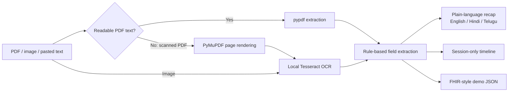

# Aarogya — AI-Powered Personal Health Copilot

A Streamlit prototype for collecting health report text, extracting a few explicit fields, and reviewing them in a session-level timeline. Despite the challenge framing, this starter intentionally uses transparent local rules rather than claiming to connect to an AI model.

## Run locally

1. Create and activate a Python virtual environment.
2. Install the Python dependencies: `pip install -r requirements.txt`
3. Start the app: `streamlit run app.py`

Text-based PDFs are parsed with pypdf. Image uploads and scanned PDFs use Tesseract OCR; install the Tesseract application separately and make sure `tesseract.exe` is on `PATH`. For OCR languages beyond Tesseract's default English, install the corresponding language data and configure the local Tesseract installation. OCR of handwriting and mixed-language reports is not supported reliably.

## Website screens

- **Overview:** Session record counts, a first-record call to action, and recent uploads.
- **Add a record:** Upload a PDF/image or paste report text; review extracted text before relying on it.
- **Health summary:** Choose a source record and view its recap in English, Hindi, or Telugu.
- **Timeline:** Browse records and extracted details in session order.
- **FHIR / ABHA demo:** Preview and download a mock FHIR-style JSON bundle.
- **How it works:** Review the extraction pipeline, data model, and limitations.

The layout adapts to narrow screens. Navigation and records remain within the active Streamlit session.

## Publish a shareable website

The `localhost` address is only reachable from the computer running Streamlit. To let people open the app from other networks, deploy it to a public host:

1. Create a GitHub repository and add `app.py`, `requirements.txt`, `packages.txt`, `README.md`, `test_app.py`, and `.gitignore`. Do not upload `.venv`, uploaded health records, or secrets.
2. Open [Streamlit Community Cloud](https://share.streamlit.io/) and sign in with GitHub.
3. Choose **Create app**, select the repository and branch, and set the app file to `app.py`.
4. Choose **Deploy**. Once deployment finishes, share the HTTPS app URL provided by Streamlit.

`requirements.txt` installs the Python libraries, and `packages.txt` installs the system Tesseract package used for OCR. Text-based PDFs can be extracted without Tesseract.

**Privacy warning:** the hosted demo does not have user accounts or access controls. Do not upload real medical records or personal health information. The hosting service processes uploaded files in memory; session-only storage is not a substitute for production security or privacy safeguards.

## Prototype pipeline

## Data and safety notes

- Records, extracted text, and summaries are held in Streamlit session state; nothing is written by this app to a database or persistent file. The active Streamlit host still handles uploaded bytes in memory.
- The extractor looks for dates, medicine-like lines with a dose, `Diagnosis:`/`Impression:` labels, and lab values accompanied by an explicit reference interval. These are best-effort text patterns, not clinical NLP.
- A value is compared only with the reference interval included on that report. No reference interval is inferred. OCR and extraction output must be checked against the original.
- The JSON export is a small FHIR-style demo bundle with `Patient`, `DocumentReference`, and `Observation` resources. It is not a validated FHIR/ABDM implementation and does not communicate with ABDM or an ABHA account. Use dummy IDs only.
- Summaries are not diagnoses or medical advice. Consult a qualified healthcare professional about results and care decisions.
- Hindi and Telugu cover fixed summary phrases only. Extracted labels and values remain in the language of the source; OCR is not configured for regional-language or handwritten text by default.

## Demo walkthrough

1. Open **Add a record** and paste a sample report or upload a text PDF / image.
2. Review extracted text carefully, especially if OCR was used.
3. Open **Health summary** and switch the fixed summary wording between English, Hindi, and Telugu.
4. View the report in **Timeline**, then preview or download the dummy **FHIR / ABHA demo** JSON.
